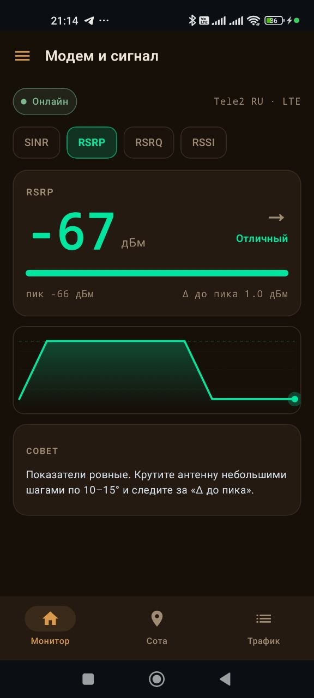

# ModemMon — modem and router monitor for OpenWrt

[Русский](README.md) | **English**

Android app for aiming the antenna, monitoring the modem and managing an
OpenWrt router (tested with Foxconn T99W175, Snapdragon X55, QMI, OrangePi Zero3).

## Screenshots

| Signal monitor | RSRP (antenna aiming) |
|---|---|
|  |  |

## Features

- Signal monitor: SINR/RSRP/RSRQ/RSSI, graphs, peak signal
- **Parking-sensor sound** (sound setting): while aiming the antenna, the beep
  gets faster the closer you get to the peak + vibration (enable in app options)
- One-tap modem switching: primary ↔ backup channel
- Speed test (Yandex.Internetometer) from the router over the selected channel
- Forkop: status, dashboard, section test, diagnostics, section/link editor
- SMS · USSD · AT commands, cells/bands
- Network: interfaces, Wi-Fi, routes, DHCP, DNS, firewall
- VPN (WireGuard/AmneziaWG), services, UCI config, terminal, files, Wake-on-LAN

## Requirements

The app works only with packages from
[https://github.com/Medvedolog/medvemodem](https://github.com/Medvedolog/medvemodem)
(medvemodem, luci-app-medvemodem and related packages).

## Installing packages on the router

Router script: [`openwrt/install-modemmon.sh`](openwrt/install-modemmon.sh) —
detects the architecture and OpenWrt version itself, downloads and installs
the packages. Run it over SSH:

```sh
sh install-modemmon.sh
```

Ready packages (tar.gz for aarch64_cortex-a53 / aarch64_generic / x86_64,
OpenWrt 24.10 and 25.12) are in
[Medvedolog/medvemodem releases](https://github.com/Medvedolog/medvemodem/releases)
and are attached to this repository's releases.

## Installing the app

Download the APK from [releases](https://github.com/franhzyz/modemmon-android/releases)
and install it on your phone. Alpha/test build.

## Languages

The app is bilingual: Russian and English. Switch in Options → "Language".

## Feedback

The app is under development — **send feedback and feature requests**:
what you would like to see, what is inconvenient, what to add.
Use [Issues](https://github.com/franhzyz/modemmon-android/issues) —
frequently requested items go into upcoming versions.

## Building from source

```sh
./gradlew assembleDebug
```
APK: `app/build/outputs/apk/debug/app-debug.apk`
