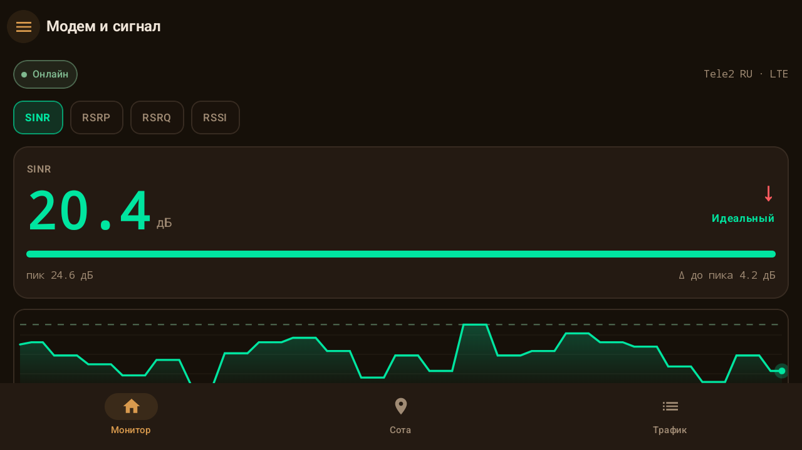

# ModemMon — монитор модема и роутера в OpenWrt

Android-приложение для наведения антенны, контроля модема и управления
роутером с OpenWrt (тестировалось под Foxconn T99W175, Snapdragon X55, QMI,
OrangePi Zero3).

## Скриншоты

| Монитор сигнала | Forkop | Секции правил |
|---|---|---|
|  

## Возможности

- Монитор сигнала: SINR/RSRP/RSRQ/RSSI, графики, пик сигнала
- **Звук-парктроник** (настройка звука): при наведении антенны писк звучит
  чаще, чем ближе к пику сигнала + вибрация (включается в опциях приложения)
- Переключение модемов: основной ↔ резервный канал, в один тап
- Спидтест (Яндекс.Интернетометр) с роутера по выбранному каналу
- Форкоп: статус, дашборд, тест секций, диагностика, редактор секций и ссылок
- SMS · USSD · AT-команды, соты/бэнды
- Сеть: интерфейсы, Wi-Fi, маршруты, DHCP, DNS, Firewall
- VPN (WireGuard/AmneziaWG), Службы, Конфиг UCI, Терминал, Файлы, Wake-on-LAN

## Требования

Приложение работает только с пакетами из репозитория
[https://github.com/Medvedolog/medvemodem](https://github.com/Medvedolog/medvemodem)
(medvemodem, luci-app-medvemodem и связанные пакеты).

## Установка пакетов на роутер

Скрипт для роутера: [`openwrt/install-modemmon.sh`](openwrt/install-modemmon.sh) —
сам определяет архитектуру и версию OpenWrt, скачивает и ставит пакеты.
Запуск на роутере по SSH:

```sh
sh install-modemmon.sh
```

Готовые пакеты (tar.gz для aarch64_cortex-a53 / aarch64_generic / x86_64,
OpenWrt 24.10 и 25.12) лежат в
[релизах Medvedolog/medvemodem](https://github.com/Medvedolog/medvemodem/releases)
и прикреплены к релизам этого репозитория.

## Установка приложения

Скачай APK из [релизов](https://github.com/franhzyz/modemmon-android/releases)
и установи на телефон. Сборка альфа/тест.

## Отзывы и предложения

Приложение развивается — **пиши отзывы и предложения** по доработке:
какие функции хотелось бы видеть, что неудобно, что добавить.
Кладём всё в [Issues](https://github.com/franhzyz/modemmon-android/issues) —
то, что чаще просят, уходит в ближайшие версии.

## Сборка из исходников

```sh
./gradlew assembleDebug
```
APK: `app/build/outputs/apk/debug/app-debug.apk`
